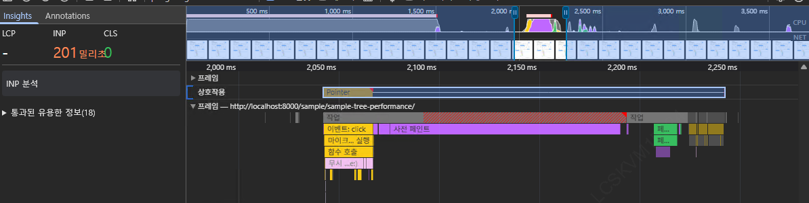

> 테스트 트리 샘플: [https://pang-ho.github.io/sample/sample-tree-performance/](https://pang-ho.github.io/sample/sample-tree-performance/)

프론트엔드 성능을 볼 때 처음에는 자연스럽게 "리렌더링이 많이 일어나나?"부터 보게 됩니다.

React Profiler를 켜고 어떤 컴포넌트가 다시 렌더링되는지, 몇 초가 걸리는지부터 확인했습니다. 그런데 이번 Tree 컴포넌트를 개선하면서 성능 테스트를 했을 때 다시 느낀 점이 있습니다.

**리렌더링만 줄인다고 끝나는 문제가 아니다.**

데이터가 많아지면 React가 컴포넌트를 계산하는 시간뿐 아니라, 브라우저가 실제 DOM을 배치하고 화면에 그리는 시간도 같이 봐야 합니다.

## 1. 브라우저는 어떤 순서로 화면을 그릴까?

브라우저가 화면을 바꾸는 흐름을 단순하게 보면 다음과 같습니다.

```
JavaScript 실행
  -> DOM 변경
  -> Style 계산
  -> Layout 계산
  -> Paint
  -> Composite
```

React에서 상태가 바뀌면 먼저 JavaScript가 실행됩니다. React는 변경이 필요한 컴포넌트를 계산하고, 실제 DOM에 반영합니다.

하지만 여기서 끝이 아닙니다. DOM이 바뀌면 브라우저는 스타일을 다시 계산하고, 각 요소의 위치와 크기를 다시 잡고, 화면에 칠하고, 최종적으로 레이어를 합성합니다.

그래서 React Profiler에서 렌더링 시간이 짧게 나와도, 실제 화면이 버벅일 수 있습니다. React 작업은 끝났지만 브라우저가 아직 layout, paint 작업을 하고 있을 수 있기 때문입니다.

## 2. 성능은 어디서 봐야 할까?

이번 테스트에서는 두 가지 도구를 같이 봤습니다.

### React Devtools - React Profiler

React Profiler는 React 컴포넌트 관점에서 봅니다.

- 어떤 컴포넌트가 렌더링됐는지
- 렌더링에 얼마나 걸렸는지
- memo가 효과가 있는지
- 상태 변경 후 어느 컴포넌트까지 다시 계산됐는지

React 컴포넌트가 불필요하게 다시 렌더링되는지 확인할 때 좋습니다.

하지만 React Profiler만 보면 브라우저의 layout, paint 비용은 놓칠 수 있습니다.

### Chrome Performance 탭

Chrome 개발자도구의 Performance 탭은 브라우저 전체 관점에서 봅니다.

- Scripting
- Recalculate Style
- Layout
- Paint
- Composite
- Input delay
- Presentation delay
- CPU 사용 흐름

사용자가 클릭했는데 왜 다음 클릭이 늦게 먹는지, 화면 반영은 됐는데 왜 브라우저가 잠깐 멈춘 것처럼 느껴지는지 확인하려면 Performance 탭을 같이 봐야 합니다.

### INP (Interaction to Next Paint)

Performance 탭에서 같이 봐야 하는 지표 중 하나가 INP입니다.

INP는 클릭 같은 상호작용이 시작된 시점부터, 그 결과가 화면에 실제로 반영되는 다음 paint까지 걸리는 시간입니다. 세 구간으로 나뉩니다.

- Input delay: 메인스레드가 다른 작업으로 바빠서 이벤트 핸들러가 아직 시작도 못한 시간
- Processing time: 이벤트 핸들러(예: React state 업데이트)가 실제로 실행되는 시간
- Presentation delay: 핸들러가 끝난 뒤 style, layout, paint, composite를 거쳐 화면에 반영되는 시간

여기서 우리가 볼 내용은, INP 종료시점과 렌더링 종료 시점입니다.

```
클릭
  -> Input delay
  -> Processing (React 렌더링 = 여기서 끝)   <- 렌더링 종료 시점
  -> Presentation delay (style/layout/paint/composite)
  -> 화면에 실제로 보임                        <- INP 종료 시점
```



이번 테스트도 시크릿 모드에서 진행했고, 가능한 확장 프로그램 영향을 줄인 상태에서 확인했습니다.

## 3. 문제 상황

프로젝트 중에 게시글을 폴더 구조로 보여주는 화면을 만들고 있었습니다. 구글 드라이브처럼 왼쪽에는 폴더 트리가 있고, 사용자는 폴더를 펼치면서 게시글을 찾아 들어가는 구조였습니다.

처음에는 사내 디자인시스템의 Tree 컴포넌트를 사용했습니다.

이 컴포넌트는 정말 편했습니다. data만 넣어주면 Tree 형태로 바로 그려줍니다. 체크박스가 필요하면 `hasCheckBox` 같은 옵션만 켜면 됩니다. 노드 UI를 직접 만들 필요도 없었습니다.

처음 데이터가 적을 때는 아무 문제가 없었습니다. 개발도 빨랐고, 화면도 정상적으로 동작했습니다. 이 정도면 끝났다고 생각했습니다.

하지만 과부하 테스트를 위해 데이터를 늘리면서 문제가 보이기 시작했습니다.

## 4. 테스트 데이터

테스트 데이터는 1000개 게시글, 5뎁스 기준으로 만들었습니다.

### 균등 트리

```
1뎁스: 20개
2뎁스: 각 5개
3뎁스: 각 1개
4뎁스: 각 1개
5뎁스: 각 10개
```

전체 데이터는 1000개 수준이지만 여러 부모 아래에 나뉘어 있는 구조입니다.

### 대용량 트리

```
1뎁스: 1개
2뎁스: 1개
3뎁스: 1개
4뎁스: 1개
5뎁스: 1000개
```

특정 부모 하나 아래에 자식이 몰려 있는 구조입니다.

실제 서비스에서도 한 폴더에 문서가 몰릴 수 있기 때문에 두 가지 형태를 같이 확인했습니다.

## 5. 첫 번째 문제: 초기 렌더링(FCP)

디자인시스템 Tree는 트리 구조의 데이터를 넘기면 내부에서 부모 자식을 트리 구조로 계산해서 그립니다.

1000개 데이터 기준으로 초기 렌더링은 약 7초가 걸렸습니다.

여기서 개선점을 생각할 때 간단하게 처리하고 싶어 "처음부터 모든 폴더와 하위 노드를 가져와서 컴포넌트로 계산 할 필요가 있을까?" 라는 생각을 하였습니다.

사용자는 처음 화면에 들어왔을 때 대부분 상위 폴더부터 봅니다. 그래서 처음에는 부모 노드와 원하는 노드가 있는 경우 찾아서 보여주고, 폴더를 클릭해서 펼칠 때 그때 자식을 가져오는 구조로 바꾸기로 했습니다.

## 6. Lazy loading 적용

처음에는 모든 폴더를 닫힌 상태로 둡니다.

사용자가 폴더를 클릭하면 그 시점에 API를 호출해서 하위 자식을 가져오고, 가져온 데이터를 Tree 데이터에 추가합니다.

```
초기 진입
  -> 부모 폴더만 렌더링

폴더 클릭
  -> 자식 데이터 fetch
  -> 해당 부모 아래에 자식 추가
  -> 자식 노드 렌더링
```

이렇게 바꾸자 초기 데이터가 적어지니 초기 렌더링은 약 0.1초 수준으로 줄었습니다.

처음에는 이 정도면 충분하다고 생각했습니다. 초기 렌더링도 빨라졌고, 필요한 데이터만 찾아서 가져오니 컴포넌트도 덜 그리게 됐습니다.

그런데 여기서 끝이 아니었습니다.

## 7. 두 번째 문제: 펼치고 닫을 때 생기는 지연

전체 트리를 펼쳐놓고 테스트를 다시 했습니다.

모든 트리를 연 상황에서, 그 폴더를 열고 닫는 동작을 반복했습니다.

React Profiler 기준으로 렌더링은 1초 안에 끝났습니다. 화면에도 열고 닫히는 상태가 바로 반영되는 것처럼 보였습니다.

그런데 이상하게도 바로 다른 버튼을 클릭하면 반응이 늦었습니다. 체감상 다음 버튼이 눌리기까지 약 4초 정도 지연이 있었습니다.

처음에는 이렇게 생각했습니다.

> "자식 노드를 건드렸는데 전체 화면이 리렌더링이 되네?"

그래서 Tree만 렌더링되도록 범위를 줄였습니다. 하지만 결과는 크게 달라지지 않았습니다.

> "부모 노드를 건드릴 때 부모와 자식 노드만 리렌더링하도록 변경하면 되지않을까?"

다음에는 누른 부모 노드와 자식 노드 중심으로만 렌더링되도록 최적화했습니다. 이때 지연은 약 4초에서 2초 정도로 줄었습니다.

하지만 여전히 사용하기 어려운 수준이었습니다.

## 8. 문제는 리렌더링만이 아니었다

여기서 중요한 점을 놓치고 있었습니다.

4뎁스 아래 5뎁스 자식은 10개뿐입니다. 크롬 리액트 DevTools로 컴포넌트 렌더링시 하이라이트로 봤을 때 4뎁스 부모를 눌러도 리렌더링 되는건 자식 10개뿐이었습니다.

> 난 분명 리렌더링을 줄였는데 왜 이렇게 느리지?

리액트의 리렌더링만으로 자식 10개가 mount, unmount 되는 비용만으로 2초 지연을 설명하기 어렵습니다. 실제 원인은 다른 곳에 있었습니다.

전체 트리가 펼쳐진 상태에서는 이미 DOM에 많은 노드가 올라와 있습니다. 이 상태에서 중간 노드를 닫으면 그 아래에 있던 10개 DOM만 사라지는 것이 아닙니다.

브라우저 입장에서는 트리의 높이가 바뀐 것입니다.

그러면 그 아래에 있는 많은 트리 노드들의 위치를 다시 계산해야 합니다. 스크롤 영역의 높이도 바뀌고, 화면에 칠해야 할 영역도 바뀌고, 클릭 가능한 위치도 다시 계산해야 합니다.

React 렌더링은 끝났지만 브라우저는 아직 바쁜겁니다.

Chrome Performance 탭으로 확인해보니, React 렌더링 시간보다 이후 페인트 작업 쪽에서 지연이 보였습니다.

## 9. Lazy loading만으로는 부족했다

Lazy loading은 초기 렌더링에는 효과가 컸습니다.

하지만 사용자가 계속 폴더를 펼치면 결국 DOM은 계속 쌓입니다.

즉 lazy loading은 "처음에 가져오고 그리는 양"을 줄여줍니다. 하지만 이미 많이 펼쳐진 뒤에는 "실제 DOM이 많아지는 문제"를 해결하지 못합니다.

무한스크롤과도 비슷합니다.

무한스크롤은 데이터를 한 번에 다 가져오지 않고 나눠 가져오는 방식입니다. 하지만 사용자가 계속 스크롤해서 게시글 DOM이 1000개 쌓이면, 결국 브라우저가 계산해야 할 DOM도 많아집니다.

데이터를 나눠 가져오는 것과 실제 DOM에 남겨두는 것은 다른 문제입니다.

## 10. 가상화 적용

그래서 `react-window`를 이용해 DOM 가상화를 적용했습니다.

가상화의 핵심은 간단합니다.

> 데이터는 1000개를 가지고 있어도, 실제 DOM에는 화면에 보이는 10~20개 정도만 렌더링한다.

Tree 데이터를 화면에 보여줄 row 목록으로 평탄화하고, 현재 펼쳐진 노드만 목록에 포함했습니다. 그리고 `react-window`로 실제 화면에 보이는 row만 DOM에 올렸습니다.

```
Tree 데이터
  -> 펼쳐진 노드 기준으로 visible rows 생성
  -> 화면에 보이는 row만 DOM 렌더링
```

이렇게 바꾸면 트리를 열고 닫아도 실제 DOM 수가 크게 늘어나지 않습니다.

대용량 트리에서 5뎁스 자식이 1000개여도 실제 DOM에는 화면에 보이는 row만 남습니다. 그래서 브라우저가 layout, paint를 다시 계산해야 하는 대상이 줄어듭니다.

## 11. 테스트 결과 정리

[테스트 트리 샘플](https://pang-ho.github.io/sample/sample-tree-performance/) AI가 만들어준 샘플을 통해 만든 테스트 결과입니다. 이번 샘플에서는 데이터를 10000개로 주었고, 대략 다음 흐름을 확인했습니다.

| 구분                | 구조                                        | 결과                                                                           |
| ------------------- | ------------------------------------------- | ------------------------------------------------------------------------------ |
| 기본 Tree           | 전체 데이터를 한 번에 Tree DOM으로 렌더링   | 초기 렌더링 약 2초, paint 약 5초, 모두 펼친 후 부모 닫는 이벤트 INP 0.8초      |
| Optimized Lazy Tree | 누른 노드와 자식 중심으로 렌더링 범위 축소  | 초기 렌더링 약 0.01초, paint 0.3초, 모두 펼친 후 부모 닫는 이벤트 INP 0.2초    |
| Virtualized Tree    | 화면에 보이는 10~20개 row만 실제 DOM 렌더링 | 대량 노드에서도 펼침/접힘 지연 크게 감소, 모두 펼친 후 부모 닫는 이벤트 0.04초 |

표의 "초기 렌더링"과 "paint"는 최초 로드 시점 기준으로, 둘을 더하면 화면에 트리가 처음 뜨기까지 걸리는 총 시간이 됩니다. 반면 "INP"는 트리를 모두 펼친 뒤 이어지는 별도 부모 닫는 이벤트의 응답 지연이라, 앞의 두 수치와 더해서 하나의 총합으로 보면 안 됩니다. 서로 다른 시점, 다른 이벤트를 재는 지표입니다.

여기서 중요한 건 "초기 렌더링이 빨라졌다"와 "사용 중에도 부드럽다"는 다른 문제라는 점입니다.

초기 렌더링은 부모만 보여주는 형식을 취해 lazy loading으로 줄일 수 있었습니다.

하지만 사용 중 펼쳐진 DOM이 많아지면, 브라우저 layout과 paint 비용이 다시 문제가 됩니다. 이때는 가상화처럼 실제 DOM 수를 줄이는 접근이 필요했습니다.

## 12. 마치며

이번 테스트를 하면서 처음 가정은 단순했습니다.

> "데이터가 많으니 React 리렌더링이 문제겠지."

하지만 실제로는 반만 맞았습니다.

React 렌더링도 중요하지만, 브라우저가 실제 DOM을 어떻게 계산하고 그리는지도 같이 봐야 했습니다.

특히 Tree처럼 중간 노드가 열리고 닫히면서 아래 요소들의 위치가 계속 바뀌는 UI는 DOM 수가 많아질수록 layout, paint 비용이 커질 수 있습니다.

결론은 이렇습니다.

1. React Profiler로 컴포넌트 렌더링 범위를 확인한다.
2. Chrome Performance 탭으로 layout, paint, input delay를 같이 확인한다.
3. DOM이 많아져 생기는 지연은 가상화로 해결하는 것이 적절하다.

프론트엔드 성능을 볼 때 "리렌더링"만 보면 원인을 놓칠 수 있습니다.

데이터가 많아질수록 실제로 화면에 올라간 DOM이 얼마나 되는지, 브라우저가 그 DOM을 다시 계산하고 그리는 비용이 얼마나 되는지도 같이 봐야 합니다.

이 내용은 리액트 DevTools로는 파악이 어렵기 때문에 언제든 Performance 탭을 이용하여 성능을 측정하자 입니다.
